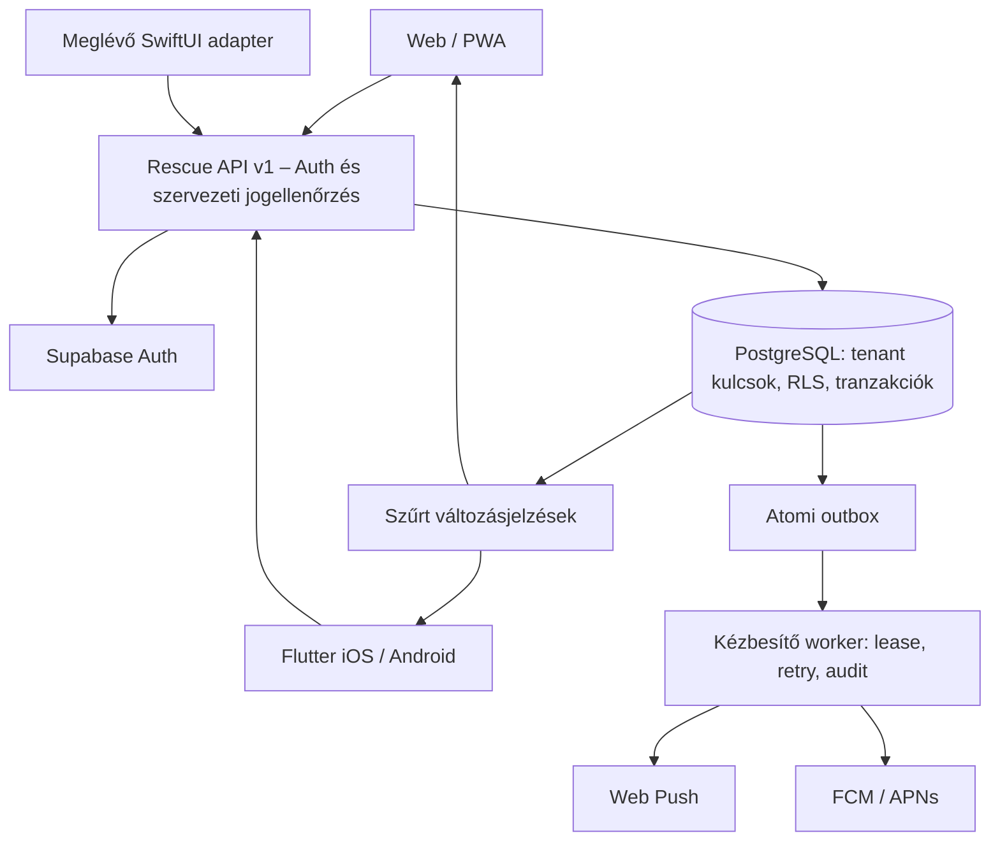

# Rescue Platform – közös architektúra, 0.1 tervezet

**CODEX-001, 2026-10-14.** Minden alábbi komponens, adatmodell és végpont **javaslat**, amennyiben nincs kifejezetten jelenlegi állapotként megjelölve. Nincs migráció, szolgáltatásbevezetés vagy előfizetés aktiválva.

## 1. Kiinduló döntés

Kezdetben közös Supabase Auth + PostgreSQL alapú, modulokra bontott backend javasolt, egy szerződéses `/v1` API-val. A web és a Flutter kliens ugyanazokat az üzleti parancsokat használja. A megtartott SwiftUI kliens kompatibilitási adapteren csatlakozhat az átmenetben. Külön adatbázis szervezetenként későbbi lehetőség olyan szervezeteknek, amelyeknél a fizikai elkülönítés elvárás; kezdetben ez több üzemeltetési munkát okozna.

Az üzleti szabályok moduljai: identity/membership, events, alerts, competencies/coins, logistics, learning/content, chat, audit. Egyelőre nem szükséges külön mikroszolgáltatás minden modulhoz. A nagyobb jogosultságú adatbázis-kapcsolat csak szűk szerveroldali modulban használható; a service_role megkerüli az RLS-t, ezért nem helyettesítheti a szervezeti jogosultság-ellenőrzést.

## 2. Szervezeti adatok elkülönítése

### Javasolt alapmodell

| Entitás | Hatókör és invariáns |
|---|---|
| auth.users / user_profiles | Globális belépési identitás, minimális saját alapadat; nem szervezeti szerepkör |
| organizations | Szervezet UUID, név, időzóna, üzemelési állapot |
| organization_memberships | Saját UUID, organization_id + user_id egyedi; pending/approved/suspended/left; egy személy több szervezet tagja lehet |
| membership_roles / permissions | Szervezeti tagsághoz rendelt, auditált szerepek és jogok; nincs globális „HUNOR admin” új szervezetek fölött |
| member_operational_profiles | Szervezeti beosztás, képesség, megye, szolgálati hely, riaszthatóság |
| member_sensitive_details | Külön egészségügyi/okmány adattárolás és célhoz kötött saját/admin/tagságkezelő hozzáférés |
| events / participants | organization_id minden soron; participant szervezeti tagság UUID-val, role és lifecycle |
| alerts / recipients / delivery_attempts | Szervezeti eseményhez kötött riasztás, személyenkénti meghívás, külön kézbesítések és válaszok |
| coin_transactions / assessments | Szervezeti napló, szabályverzió, jóváhagyás, forrás-egyediség, korrekciós hivatkozás |
| outbox / audit_log | Tenant + actor + művelet + idő + request_id, személyes payload és titkok nélkül |

Minden üzleti táblán nem null tenant kulcs. A gyermekkapcsolatokat **összetett FK** védi: például `(organization_id,event_id)` → events `(organization_id,id)`; tagságra ugyanígy. Így admin/worker hibából sem köthető az A szervezet riasztása a B tagjához. Tenant mező módosítása tiltott; áthelyezés külön auditált üzleti folyamat, nem egyszerű UPDATE.

Szervezeti név, email-domain, kliensoldali legördülő vagy tetszőlegesen küldött header nem jogosultságforrás. Az API útvonal tenant UUID-ját minden műveletnél friss, jóváhagyott tagság igazolja. RLS a közvetlen REST, Realtime és Storage hozzáférésen is megismétli az izolációt. A JWT szerepkörpillanatképe csak gyorsítótár lehet; érzékeny művelet friss adatbázisos jogot és szükség szerint session-visszavonást ellenőriz.

Storage útvonal: `organization_id/resource_id/random_file_id`, privát bucket és rövid élettartamú aláírt URL. Fájl MIME/méret ellenőrzés; útvonalönmagában nem hozzáférési védelem. Realtime csatornák tenant/recipient szűréssel, RLS-szel; az összes szervezet változásainak közös nyilvános streamje tiltott.

## 3. Szerveroldali szerepek és jogok

| Művelet | Javasolt szervezeti jogosult |
|---|---|
| Saját profil és saját részvételi válasz | Jóváhagyott tag, kizárólag saját tagság |
| Tagság/jegyzék szerkesztése | organization_admin, membership_manager; egészségügy/irat külön auditált cél |
| Esemény szervezése | organization_admin, event_manager/editor |
| Riasztás kiadása, lezárása, helyettesítés | **Csak organization_admin** |
| EXCON jelentkezés/értékelés | Megfelelő EXCON jog és eseménykijelölés |
| RC jóváírás véglegesítése/korrekció | organization_admin vagy külön, jóváhagyott coins.manage jog; API v0.1 csak olvas |
| Platform-admin | Környezet/provisioning, szervezetek működtetése; nincs automatikus hozzáférés tagi egészségügyi adathoz |

A megosztott admin hozzáféréshez rendkívüli, időkorlátos, indokolt és naplózott támogatási folyamat javasolt. A „platform admin” és „szervezet admin” külön szerepkör. A profilbeosztás a riasztási szerepre való alkalmasság egyik feltétele, nem önmagában rendszerjog. Szabad szöveges készségbevitel mellé ellenőrzött képességkatalógus/igazolás tervezendő.

## 4. Riasztási folyamat

1. Admin tervezetet hoz létre, konkrét szervezeti tagságokkal, pozíciókkal és lejárattal. Ez nem küld push-t.
2. A dispatch parancs tranzakcióban újraellenőrzi a friss adminjogot, szervezetet, tagállapotot, riaszthatóságot, beosztást, eseményt és időt.
3. A végleges riasztás, címzettek és outbox egy tranzakcióban rögzül. Idempotency-Key megismétlése nem küld új riasztást.
4. Worker csak a címzettek aktív, megfelelő providerhez tartozó eszközeire küld. Egyedi `(alert,recipient,installation,attempt)` követés, lease + backoff/jitter, felső próbálkozási korlát és kézi újraindítási napló.
5. **provider_accepted ≠ device_received ≠ human_acknowledged ≠ going.** Ezek külön állapotok. Push payloadban csak minimális cím és azonosító, védett részletek belépés után.
6. A nyugtázás önálló emberi művelet. Igen/nem részvételi válasz implicit nyugtázásnak számíthat; a puszta készülékátvétel nem.
7. A nemet válaszoló előzménye megmarad. Admin új személyt választ ugyanabba a slotba; az új meghívás hivatkozik a régire. Csak az új címzett kap új kézbesítést. Régi/helyettesített meghívásra új válasz 409.
8. Lezárás és lejárat megállítja a sorban maradt kézbesítéseket/válaszokat. A már OS-nek átadott push nem garantáltan vonható vissza.

Eszköztelepítés külön UUID-t kap; `provider` (webpush/fcm/apns), provider-token és környezet explicit. Egy token nem kezelhető egyszerre nyers APNs és FCM regisztrációként. Kijelentkezés/fiókváltás leválasztja a készülék tagsági kötését. A mobil push engedély, hangeszköz és foreground/background viselkedés platformonként tesztelendő; a rendszer nem ígér kényszerített, végtelen szirénát lezárt telefonon.

## 5. Mobil API és szinkron

A [rescue-platform-openapi.yaml](rescue-platform-openapi.yaml) az első közös szerződés. HTTPS + ellenőrzött Bearer JWT, szerveridő, UTC date-time, szervezeti útvonal, egyértelmű saját erőforrások. Mobil refresh token védett OS tárba kerül; böngészős HttpOnly session/BFF külön döntés, nem lehet ugyanazt a tokent kontroll nélkül több tárolóban tartani.

Írások: szerveroldali validáció, idempotencia és szükség szerint erős ETag/If-Match. Jogosultságot a szerver számít, a kliens nem küld role/member_id mezőt saját válasznál. Offline válasz csak „küldésre vár” állapotot mutathat, szervervisszaigazolásig nem zöldülhet véglegesre. Újracsatlakozáskor tokenfrissítés, változáskurzor és állapotegyeztetés; lejárt riasztásra a tárolt offline válasz elutasítható.

Listák max.100-as kurzoros lapozással, stabil rendezéssel. Nagy bináris fájlok nem JSON API-n keresztül. Szűrt Realtime változásjelzés indít célzott újraolvasást; megkezdett űrlap nem írható felül. Push csak ébresztési jelzés, nem a hiteles adatforrás. Auth/riasztási/irat API válaszok `Cache-Control: no-store`; listacache csak tenant + actor + permissions version kulccsal.

## 6. Rescue Coins

Szervezetenként elkülönített, egész számú RC napló. Nem pénzügyi egyenleg és nem előfizetési kredit. A lakossági LRC játék külön identitás-, hozzájárulás-, kutatási és pontozási tartomány; nem konvertálódik automatikusan csapattagi RC-re.

Esemény → igazolt jelenlét/teljesítés → verziózott szabály alapján szerveroldali számítás → jóváhagyás → egyszeri, megváltoztathatatlan tranzakció. Egyedi forráskulcs a szervezettel együtt, auditált korrekció külön előjeles sorban. A negatív korrekció után az egyenleg akár negatív lehet; ezt az API nem maszkolja. Kutatási export külön cél/jog, szervezeti pseudonym, adatkezelési határ; egészségügyi adatot nem emel át.

## 7. Későbbi előfizetés – csak előkészítés

Javasolt táblák: organization_subscriptions, plan_versions, entitlements, usage_counters, billing_events. A számlázó ügyfél a szervezet, nem a mentő személye. A feature jogot a szerveroldali entitlement adja; kliensoldali gombelrejtés és tokenbe égetett előfizetés nem elég.

Későbbi fizetési webhook csak ellenőrzött aláírással, eseménydeduplikációval, idősorrend-kezeléssel frissíthet. Az RC napló nem számlázási nyilvántartás. Most nincs kiválasztott/aktivált szolgáltató, díjcsomag vagy fizetés. Trial, seat és tárhelykvóta üzleti döntés.

**Műveleti biztonság:** lejárt előfizetés nem akadályozhatja már kiküldött riasztás nyugtázását, válaszát és az alapvető biztonsági adatokhoz való hozzáférést. Új, nem sürgős létrehozás korlátozása, türelmi idő, read-only mód és adatexport megőrzése külön döntés és teszt szükséges. Szolgáltatáskiesésre kézi kapcsolattartási tartalékfolyamat kell.

## 8. Átmenet, a működés megtartásával

1. **Vezetői döntés:** kanonikus Supabase projekt, web/backend forráshelye, Flutter vs Swift fenntartási idő, szervezeti modell és API v0.1 jóváhagyása.
2. **Külön engedélyezett staging baseline:** az élő séma/grant/function/storage/realtime konfiguráció reprodukálása; személyes adatok nélkül vagy szintetikus készlettel. Migrációpróba és visszaállítási terv.
3. **Izolációs prototípus:** A és B szervezet, többes tagság, suspend/revoke, hamis FK/tenant, közvetlen REST/RPC/Storage/Realtime negatív tesztek. Először egyetlen pilot szervezet.
4. **Kompatibilis adapter:** meglévő HUNOR táblák/RPC-k és az új API párhuzamosan, egyetlen üzleti írási forrás. Nincs kontrollálatlan kettős írás. Idempotens, ellenőrzött backfill csak új feladatban.
5. **Riasztási pilot:** outbox + eszköztípusok + készülékteszt, régi broadcast útvonal kivezetése csak jóváhagyott átállással; meglévő funkciót e PR nem töröl.
6. **RC olvasási adapter**, majd külön írási/értékelési szerződés. Szabályverziók és egyenlegek egyeztetése.
7. **Élesítés később:** ellenőrzött CI, külön környezeti titkok, változásjóváhagyás, mérés/riasztás, adatbázis mentés-visszaállítás teszt, fokozatos kliensváltás és rollback.

Az elkülönített környezetek javaslata nem jelent most új fizetős projekt létrehozását. A költség és régió, megőrzés, SLA/RPO/RTO még vezetői döntés; számokat nem feltételezünk.

## 9. Jóváhagyandó nyitott kérdések

- A `...qgfik` és `...qqfik` projektcím közül melyik a kanonikus mobil/backend környezet? A jelenlegi webes bizonyíték az utóbbira mutat.
- Egy személy több szervezetben milyen adatokat oszthat meg; egészségügy/irat minden szervezetben külön jogalapú?
- Megtartjuk-e hosszabb távon a natív SwiftUI klienst, vagy Flutter az elsődleges?
- Milyen pozíció/képesség igazolt és ki hitelesíti? Maximum slotok és helyettesítési szabályok?
- Mennyi ideig módosítható a részvételi válasz; a nyugtázás explicit plusz implicit válasszal elfogadott?
- Ki kezelhet RC-t az adminon kívül; milyen pontszabály és megőrzés szervezetenként?
- Auth v0.1 e-mail/jelszó adapter elfogadható-e, vagy előbb MFA/passkey szerződés szükséges?
- Milyen előfizetési korlátozás megengedett sürgős működés mellett?

## 10. Elsődleges háttérforrások

- [Supabase RLS](https://supabase.com/docs/guides/database/postgres/row-level-security): RLS/grant együtt, saját sor/szervezet ellenőrzéssel.
- [Supabase changelog – TLS cipher változás](https://supabase.com/changelog/cbc-tls-ciphers-deprecated): az API TLS-kompatibilitását a 2026. november 10-i változás előtt érdemes mobilkészüléken ellenőrizni.
- [FCM Flutter beállítás](https://firebase.google.com/docs/cloud-messaging/flutter/get-started): platformjogok és APNs/FCM előfeltételek.
- [Netlify konfiguráció](https://docs.netlify.com/build/configure-builds/file-based-configuration/): későbbi reprodukálható webes kiadás alapja.
- [OpenAPI 3.0.3](https://spec.openapis.org/oas/v3.0.3): a YAML szerződés formátuma. A 3.0.3 választás kompatibilitási döntési javaslat, nem a legújabb verzió állítása.
